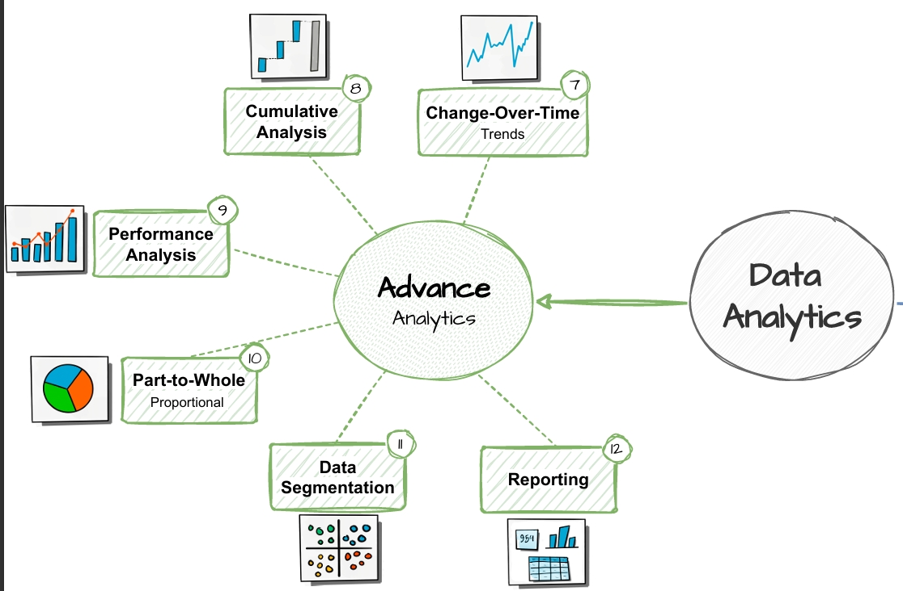
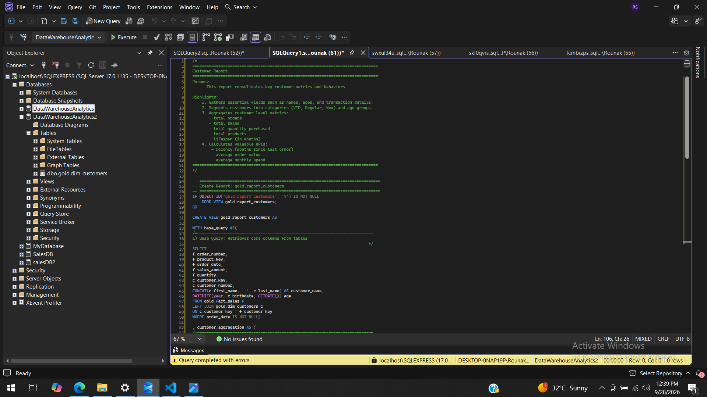
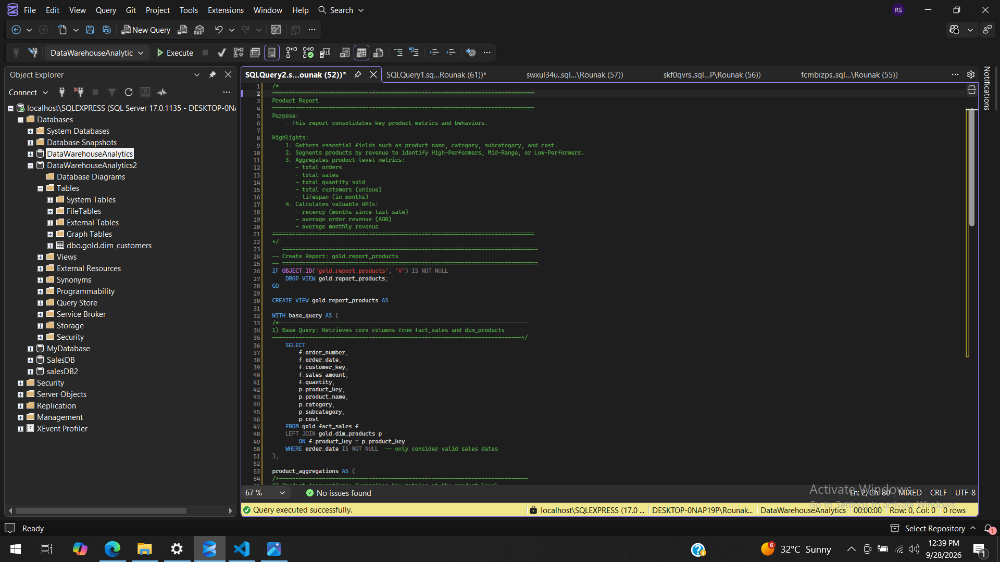

# SQL Server Data Analytics Project 📊


An end-to-end analytics project that turns raw sales data into customer, product, and business insights using **T-SQL** on Microsoft SQL Server.

---

## 🎯 Business Problem

A retail business wants to understand its sales performance. This project answers:

- Who are our most valuable customers?
- Which products and categories drive revenue?
- How do sales change over time?
- How much does each segment contribute to total revenue?

---

## 💡 Key Insights

- **Total sales:** about 29.35M across 27,659 orders and 18,482 customers
- **Top category:** Bikes contribute 96.5% of total revenue (28.31M), followed by Accessories (2.4%) and Clothing (1.2%). The business is heavily dependent on a single category
- **Trend:** Sales peaked in 2013 at 16.34M (about 56% of all revenue), up roughly 180% from 2012 (5.84M). 2012 had declined about 17% from 2011 (7.08M). 2010 and 2014 have very small totals, which suggests partial-year data
- **Customers:** Only 8.9% of customers (1,653) are VIP, yet they generate 36.7% of revenue (10.76M). New customers make up 79.2% of the base and 37.8% of revenue, so there is a large opportunity to convert them into repeat buyers
- **Products:** 66 High-Performers (of 130 products) generate 94.2% of sales (27.64M). Only 6 products are Low-Performers, contributing just 35.7K in total, so they are candidates for review

---

## 🗄️ Dataset

| Table | Type | Description |
|---|---|---|
| `gold.dim_customers` | Dimension | Customer details (name, country, gender, birthdate) |
| `gold.dim_products` | Dimension | Product details (category, subcategory, cost) |
| `gold.fact_sales` | Fact | Transactions (order date, sales, quantity, price) |

---

## 📂 Project Structure

```text
sql-server-data-analytics-project/
│
├── datasets/
│   ├── gold.dim_customers.csv
│   ├── gold.dim_products.csv
│   └── gold.fact_sales.csv
│
├── docs/
│   ├── customer_report.png
│   ├── product_report.png
│   └── workflow.jpeg
│
├── scripts/
│   ├── 00_init_database.sql
│   ├── 01_database_exploration.sql
│   ├── 02_dimensions_exploration.sql
│   ├── 03_date_range_exploration.sql
│   ├── 04_measures_exploration.sql
│   ├── 05_magnitude_analysis.sql
│   ├── 06_ranking_analysis.sql
│   ├── 07_change_over_time_analysis.sql
│   ├── 08_cumulative_analysis.sql
│   ├── 09_performance_analysis.sql
│   ├── 10_data_segmentation.sql
│   ├── 11_part_to_whole_analysis.sql
│   ├── 12_report_customers.sql
│   └── 13_report_products.sql
│
├── LICENSE
└── README.md
```

---

## 🔄 Analytical Workflow



---

## 🔍 Analysis Modules

| # | Script | Technique | Question Answered |
|---|---|---|---|
| 01 | Database Exploration | `INFORMATION_SCHEMA` | What tables and columns exist? |
| 02 | Dimensions Exploration | `DISTINCT` | What categories, countries, and products do we have? |
| 03 | Date Range Exploration | Date functions | What period does the data cover? |
| 04 | Measures Exploration | Aggregates | What are the headline KPIs? |
| 05 | Magnitude Analysis | `GROUP BY` | How do measures break down by dimension? |
| 06 | Ranking Analysis | `RANK`, `TOP` | Who are the top and bottom performers? |
| 07 | Change-Over-Time | `DATETRUNC`, `FORMAT` | How do sales trend by month and year? |
| 08 | Cumulative Analysis | Window functions | What are running totals and moving averages? |
| 09 | Performance Analysis | `LAG`, `AVG() OVER` | How does each period compare with the previous one or the average? |
| 10 | Data Segmentation | `CASE` | Which customers and products fall into which groups? |
| 11 | Part-to-Whole | Window `SUM` | How much does each category contribute to the total? |
| 12 | Customer Report | CTEs, Views | What does a full customer profile look like? |
| 13 | Product Report | CTEs, Views | What does a full product profile look like? |

---

## 📑 Final Reports

### 👥 Customer Report (`gold.report_customers`)

**Metrics:** total orders, total sales, total quantity, total products, lifespan (months), recency (months), average order value, average monthly spend

**Segments:**

| Segment | Rule |
|---|---|
| VIP | 12+ months of history and total sales > 5,000 |
| Regular | 12+ months of history and total sales ≤ 5,000 |
| New | Less than 12 months of history |

**Age groups:** Under 20, 20-29, 30-39, 40-49, 50 and above

### 📦 Product Report (`gold.report_products`)

**Metrics:** total orders, total sales, total quantity sold, unique customers, lifespan, recency, average order revenue, average monthly revenue

**Segments:**

| Segment | Rule |
|---|---|
| High-Performer | Total sales > 50,000 |
| Mid-Range | Total sales between 10,000 and 50,000 |
| Low-Performer | Total sales < 10,000 |

---

## 🖼️ Report Previews

**Customer Report**



**Product Report**



---

## 🧪 Sample Query

Running total and moving average of sales by month:

```sql
SELECT
    order_month,
    total_sales,
    SUM(total_sales) OVER (ORDER BY order_month) AS running_total_sales,
    AVG(avg_price)   OVER (ORDER BY order_month) AS moving_avg_price
FROM (
    SELECT
        DATETRUNC(month, order_date) AS order_month,
        SUM(sales_amount)            AS total_sales,
        AVG(price)                   AS avg_price
    FROM gold.fact_sales
    WHERE order_date IS NOT NULL
    GROUP BY DATETRUNC(month, order_date)
) t;
```

---

## 🧠 SQL Skills Demonstrated

`SELECT` · `WHERE` · `GROUP BY` · `JOINs` · `CASE` · Subqueries · CTEs · Window Functions · Date Functions · Views · KPI Calculations · Ranking · Segmentation · Time-Series Analysis

---

## 🚀 How to Run

1. Install **SQL Server** and **SSMS**.
2. Run `scripts/00_init_database.sql` to create the database and tables.
3. Import the three CSV files from `datasets/` into the `gold` schema tables.
4. Run scripts `01` to `13` in order.

---

## 👤 About Me

**Rounak** · B.Tech Data Science student, aspiring Data Analyst

[LinkedIn](https://linkedin.com/in/rounak-r02) · [GitHub](https://github.com/rounak02-cell)

---

## 📄 License

This project is licensed under the MIT License. See [LICENSE](LICENSE) for details.
